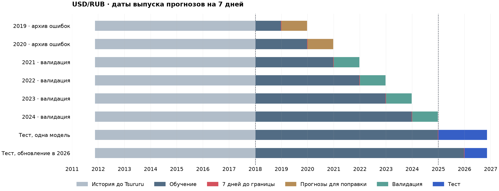

# USD/RUB на временных сплитах Tsururu

На фолдах 2021–2024 годов недельный RMSE снова выбрал классический ансамбль без XGBoost. На прежнем тесте 2025–2026 переобученный ансамбль с 50% поправки снизил недельный RMSE с 1,6752 до 1,6071 ₽. Парный 95%-й интервал выигрыша от −0,005 до +0,155 ₽ включает ноль. Опубликованная версия воспроизвела 1,5943 ₽.

## Как разбиты даты



`TimeSeriesValidator(n_splits=6)` вызывает `TimeSeriesSplit`. Ему передано семь блоков по 365 календарных дней с 03.01.2018 по 31.12.2024. Первый блок служит начальным обучающим окном. Затем Tsururu на каждом шаге добавляет предыдущий блок к обучению и выделяет следующие 365 дней на проверку. Сдвиги относительно 1 января получились из-за одинаковой длины блоков и високосных лет. [Код валидатора Tsururu](https://github.com/sb-ai-lab/tsururu/blob/3fd789fb0bad562fc18d72f24cb24c91d531cf4f/tsururu/model_training/validator.py)

| Фолд | Блок Tsururu или теста | Даты прогноза с известной недельной целью внутри блока | Последний обучающий origin на 7 дней | Роль |
| --- | --- | --- | --- | --- |
| 2019 | 03.01.2019–02.01.2020 | 03.01.2019–26.12.2019 | 26.12.2018 | Архив ошибок |
| 2020 | 03.01.2020–01.01.2021 | 03.01.2020–25.12.2020 | 26.12.2019 | Архив ошибок |
| 2021 | 02.01.2021–01.01.2022 | 02.01.2021–25.12.2021 | 25.12.2020 | Валидация |
| 2022 | 02.01.2022–01.01.2023 | 02.01.2022–25.12.2022 | 25.12.2021 | Валидация |
| 2023 | 02.01.2023–01.01.2024 | 02.01.2023–25.12.2023 | 25.12.2022 | Валидация |
| 2024 | 02.01.2024–31.12.2024 | 02.01.2024–24.12.2024 | 25.12.2023 | Валидация |
| 2025–2026 | 01.01.2025–18.11.2026 | 01.01.2025–11.11.2026 | 24.12.2024 | Тест с одной версией модели |
| 2026 | 01.01.2026–18.11.2026 | 01.01.2026–11.11.2026 | 24.12.2025 | Тест после обновления |

Tsururu задаёт границы, а код проекта проверяет зрелость меток. Для границы `B` и горизонта `h` в обучение попадают строки с `origin + h < B`. Поэтому последняя обучающая строка для недели — `B − 8 дней`, а для одного дня — `B − 2 дня`. Из конца каждого проверочного блока убраны семь дат выпуска, чтобы все недельные цели остались внутри блока. В таблице для каждого горизонта используются одни и те же даты выпуска.

Ridge основного ансамбля использует расширяющуюся историю с 17.11.2011, а HistGradientBoosting и Extra Trees — последние 1 460 календарных дней до границы. На шкале показана расширяющаяся история. Параметры моделей фиксировались на начало каждого блока. Каждый день прогноз пересчитывался на новых доступных признаках и новом курсе-якоре. Блоки 2019–2020 дали 716 вневыборочных прогнозов для первого фолда подбора поправки. До теста этот архив вырос до 2 148 прогнозов.

## Что получилось на 680 тестовых датах

Валидация берёт среднее четырёх отношений недельного RMSE к случайному блужданию. При равенстве используется среднее по горизонтам 1–7 дней. На тесте RMSE и MAE рассчитаны в рублях за доллар.

| Прогноз | RMSE 7 дней к RW на валидации | RMSE 1 день, ₽ | RMSE 7 дней, ₽ | MAE 7 дней, ₽ |
| --- | ---: | ---: | ---: | ---: |
| Случайное блуждание | 100,00% | 0,5812 | 1,7355 | 1,2852 |
| Классический ансамбль | **94,87%** | 0,4574 | 1,6752 | 1,2798 |
| Опубликованный ансамбль с 50% XGBoost | — | **0,4487** | **1,5943** | 1,2412 |
| Tsururu, фиксированные 8 признаков и 50% XGBoost | 96,69% | 0,4520 | 1,6071 | 1,2472 |
| Tsururu, 8 признаков по TreeSHAP/gain внутри фолда и 50% XGBoost | 97,31% | 0,4522 | 1,6091 | 1,2494 |
| Tsururu, 21 признак и 50% XGBoost | 97,52% | 0,4517 | 1,6084 | 1,2426 |
| 25% XGBoost на 8 признаках, вес вдвое ниже при высокой волатильности | 94,88% | 0,4527 | 1,6386 | 1,2566 |

Опубликованный вариант с 50% XGBoost был выбран после просмотра того же теста. В новом прогоне эта строка служит проверкой воспроизведения. Сам тест остаётся историческим и повторно использованным. Веса и параметры классической базы взяты из прежних экспериментов, в которых использовалась часть дат 2021–2024. Часть макроэкономических признаков построена из текущих винтажей с лагами публикации, поэтому фактические исторические ревизии могли бы изменить цифры.

На 315 датах 2026 года обновление классики и поправки на 01.01.2026 снизило недельный RMSE переобученной модели с 1,6190 до 1,5797 ₽. У классической базы — с 1,6077 до 1,5863 ₽. Обе пары рассчитаны на одних и тех же датах 2026 года.

## Что проверено из лекции

- **Уровни и доходности, слайды 4, 8–13.** ADF и KPSS на ряду до 2025 года согласуются со стационарностью дневных лог-доходностей. Для лог-уровня ADF даёт `p = 0,636`, а KPSS отвергает стационарность на 1%-й границе таблицы. На неделе лучший AR-вариант на тесте дал 1,7636 ₽, случайное блуждание — 1,7355 ₽. Проверены AR(1) в уровнях и логарифмах, AR(1) на лог-доходностях с двумя окнами, прямая AR(3) и случайное блуждание с дрейфом.
- **Поправка по архиву ошибок, слайды 15–23.** Сравнены XGBoost на лог-ошибке, XGBoost и Ridge на ошибке в рублях, дополнительный лаг уже известной ошибки и уменьшение веса при высокой волатильности. Прямой XGBoost на тех же входах и строках дал 1,7824 ₽ на неделе, XGBoost на ошибке в рублях с весом 100% — 1,7519 ₽. Усадка последнего до 25% дала 1,6226 ₽ на тесте и 95,12% от RW на валидации. Ridge с лагом и весом 50% дал 0,4472 ₽ на день и 1,7127 ₽ на неделю.
- **Интервалы, слайды 31–35.** Квантиль считался по последним 365 дозревшим абсолютным ошибкам отдельно для каждого горизонта. Для номинального 90%-го недельного интервала покрытие составило 92,8%, средняя ширина — 6,10 ₽, interval score — 7,17 ₽. При нормировании ошибок на 21-дневную волатильность и обратном масштабировании получилось 91,9%, 6,87 ₽ и 8,18 ₽. На одном дне у обеих версий покрытие 92,8% при ширине 1,77 и 1,90 ₽.
- **Зависимость и значимость, слайды 36–41.** У недельных остатков и их квадратов Ljung–Box отвергает отсутствие автокорреляции. Семидневные цели соседних дат перекрываются. DM с поправкой HLN, HAC на 28 лагах и Holm по 16 сравнениям не выявил значимого выигрыша на горизонте 7 дней. Для выигрыша переобученной 50%-й поправки к классической базе границы бутстрэп-интервала пересекали ноль при длинах блока 14, 28 и 56 дней.

## Повтор прежних экспериментов

HistGradientBoosting, CatBoost и Extra Trees переобучены с параметрами прежнего опыта по компактным деревьям. Сравнены полная панель и 32 или 64 признака по Ridge. Для HistGradientBoosting дополнительно проверен такой же бюджет по TreeSHAP/gain. Ко всем прогнозам в таблицах применён календарь ЦБ. У всех трёх моделей недельная валидация выбрала top32 по Ridge.

| Модель | Панель | RMSE 7 дней к RW на валидации | RMSE 1 день, ₽ | RMSE 7 дней, ₽ |
| --- | --- | ---: | ---: | ---: |
| HistGradientBoosting | top32 по Ridge | **96,27%** | 0,4649 | **1,6724** |
| HistGradientBoosting | полная | 97,60% | 0,4553 | 1,6944 |
| HistGradientBoosting | top64 по TreeSHAP/gain | 98,29% | 0,4552 | 1,6919 |
| CatBoost | top32 по Ridge | 97,15% | 0,5071 | 1,7054 |
| Extra Trees | top32 по Ridge | 99,04% | 0,5211 | 1,7074 |

У компактного HistGradientBoosting недельный RMSE на тесте оказался на 0,0028 ₽ ниже классического ансамбля. На фолдах до 2025 года классический ансамбль получил 94,87% к RW против 96,27% у бустинга.

Обучены LSTM, GRU, CNN и Transformer на полной доступной панели и top64, а также внеоконный Ridge. Масштабирование и ранжирование пересчитывались в каждом фолде. Эпохи и усадка подбирались по недельному RMSE. Все восемь сетей выбрали четыре эпохи и вес поправки 25%.

| Нейросеть | Панель | RMSE 7 дней к RW на валидации | RMSE 1 день, ₽ | RMSE 7 дней, ₽ |
| --- | --- | ---: | ---: | ---: |
| Transformer | top64 | **97,57%** | 0,5548 | 1,7189 |
| LSTM | полная | 97,70% | 0,5719 | 1,7878 |
| LSTM | top64 | 97,72% | 0,5622 | 1,7097 |
| GRU | top64 | 97,75% | 0,5584 | **1,6979** |
| CNN | top64 | 98,89% | 0,5608 | 1,7168 |

## Воспроизведение

Tsururu закреплён на ревизии `3fd789fb0bad562fc18d72f24cb24c91d531cf4f`. Для этой ревизии используется Python 3.11–3.13. Основной прогон читает локальный снимок с 21 макропризнаком из [эксперимента с фундаментальными признаками](theory_holdout.md). Деревья и нейросети используют версионированный `datasets/usd_rub_2011_2026_full.csv.gz`.

```bash
uv run --locked --extra research --extra ml python scripts/tsururu_holdout.py
uv run --locked --extra research --extra ml python scripts/tsururu_repeats.py trees
uv run --locked --extra research --extra sequence python scripts/tsururu_repeats.py sequence
```

В `data/reports/tsururu_holdout/` сохранены `splits.csv` с фактическими границами, `metrics.csv` с оценкой по годам и горизонтам, `predictions.csv.gz` с прогнозами, `correction_features.csv` со списками признаков, `diagnostics.csv`, `interval_metrics.csv` и `paired_tests.csv`. Файлы `trees_*.csv` и `sequence_*.csv` содержат рейтинги и метрики повторных экспериментов.
